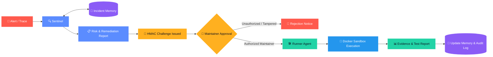

<div align="center">

# 🫀 DevPulse

### Autonomous PR & Incident Triage Engine with Persistent Memory

**Detect  ·  Recall  ·  Investigate  ·  Remediate  ·  Verify  ·  Remember**

<br />


<br />

> **Every incident becomes intelligence. Every fix becomes future knowledge.**

[Overview](#-overview) ·
[How It Works](#-how-it-works) ·
[Architecture](#-architecture) ·
[Live Demo & Quick Start](#-quick-start) ·
[Persistent Incident Memory](#-persistent-incident-memory) ·
[Verifiable Security](#-verifiable-security) ·
[Verification & Tests](#-verification--test-suite) ·
[Roadmap](#-roadmap)

</div>

---

## 📖 Overview

DevPulse is an autonomous incident investigation, verification, and remediation engine built for **Switch Console**. It operates two specialized AI agents alongside human maintainers within a shared Switch room.

When an incident or alert enters the room, DevPulse investigates the error trace, recalls similar historical resolutions from persistent memory, diagnoses the root cause, and synthesizes a verifiable fix. The fix is tested inside a hardened, network-isolated Docker sandbox and cryptographically sealed. **No code change is ever executed or published without explicit, authenticated approval from an allowlisted human maintainer.**

| Component | Role in Room |
|---|---|
| 🔍 **Sentinel Agent** | Ingests alerts, parses stack traces, searches historical incident memory, synthesizes root cause, and generates cryptographic approval challenges (`appr_...`). |
| 🛠️ **Patch & Test Runner** | Executes approved patches inside hardened, network-isolated Docker containers (`--network none`, read-only rootfs), runs verification suites, and captures evidence. |
| 👤 **Human Maintainer** | Reviews exact diffs and risk reports in Switch Console, authorizing remediation tasks via `@devpulse approve <challenge_id>`. |
| 🧠 **Incident Memory Store** | Dual-layer JSONL and Markdown knowledge base preserving incident precedents, error signatures, root causes, and verified fixes. |
| 🧾 **Audit Logger** | Append-only, tamper-evident cryptographic log with monotonic sequence numbers and HMAC SHA-256 hash chaining. |

---

## ⚙️ How It Works



### The 9-Stage Incident Lifecycle

1. **Detection & Ingestion:** Incident alert or raw stack trace enters the Switch Console room.
2. **Sentinel Investigation:** Sentinel extracts error signatures, culprit frames, and affected modules.
3. **Historical Memory Recall:** Queries `data/incidents.jsonl` for similar past incidents (`INC-2026-PAST01`).
4. **Remediation Synthesis:** Generates candidate patch diff and binds it to a cryptographic `specHash`.
5. **Approval Challenge:** Sentinel posts investigation report and issues a 5-minute ephemeral challenge (`appr_...`).
6. **Maintainer Authorization Gate:** Validates sender against allowlist; unauthorized users are rejected immediately.
7. **Atomic Challenge Consumption:** Authorized approval atomically consumes the challenge, preventing replay attacks.
8. **Hardened Docker Execution:** Runner applies the patch and executes verification commands inside an offline Docker sandbox.
9. **Evidence Reporting & Memory Anchoring:** Raw test outputs and diffs post back to Switch Console; resolved incident is committed to memory and hash-chained in the audit log.

---

## 🏗️ Architecture

```
                  ┌────────────────────────────────────────────────────────┐
                  │                 Switch Console Room                    │
                  │   (WebSocket Event Stream + REST Messaging Endpoint)   │
                  └───────────────▲────────────────────────▲───────────────┘
                                  │                        │
                      Inbound Room Events           Outbound Reports
                                  │                        │
                  ┌───────────────▼────────────────────────┴───────────────┐
                  │                    SwitchAdapter                       │
                  │       (Heartbeat Protocol, Frame Normalization)        │
                  └───────────────────────────────┬────────────────────────┘
                                                  │
                                          EventRouter
                                (Permission Gate, Idempotency)
                                  │                        │
              Incident Alert / Trace                      Maintainer Approval
                                  │                        │
                  ┌───────────────▼────────┐      ┌────────▼───────────────┐
                  │     SentinelAgent      │      │     ApprovalHandler    │
                  │  (Diagnosis, Impact,   │      │ (ChallengeTracker,     │
                  │    Risk Evaluation)    │      │  Allowlist Validation) │
                  └───────┬────────┬───────┘      └────────┬───────────────┘
                          │        │                       │
      Historical Query ───┘        └── Issues Challenge    └── Validated Task
              │                              │                         │
  ┌───────────▼───────────┐      ┌───────────▼───────────┐ ┌───────────▼───────────┐
  │     IncidentStore     │      │   ChallengeTracker    │ │      RunnerAgent      │
  │  (Dual-layer Memory,  │      │  (HMAC specHash, TTL, │ │ (Worktree Management, │
  │   Similarity Match)   │      │    Atomic Replay)     │ │   Evidence Dispatch)  │
  └───────────────────────┘      └───────────────────────┘ └───────────┬───────────┘
                                                                       │
                                                            ┌──────────▼───────────┐
                                                            │  Docker Sandbox      │
                                                            │  (--network none,    │
                                                            │   read-only rootfs)  │
                                                            └──────────────────────┘
```

### Module Responsibilities

- **`src/sentinel`**: Diagnostic engine parsing stack traces, calculating impact, risk scoring, and synthesizing diffs.
- **`src/memory`**: Persistent incident intelligence store (`JSONL` + `Markdown`) with error signature similarity search.
- **`src/approval`**: Cryptographic human-in-the-loop gate binding approvals to exact diff hashes with replay protection.
- **`src/patch-runner`**: Hardened container driver orchestrating ephemeral execution sandboxes.
- **`src/room`**: Switch Core WebSocket client handling continuous ping/pong heartbeats and message dispatch.
- **`src/router`**: Event dispatcher enforcing origin verification, sender types, and state transitions.
- **`src/audit`**: Append-only audit logger enforcing cryptographic HMAC SHA-256 hash chains across all events.

---

## 🚀 Quick Start

### 1. Prerequisites

- **Node.js**: 20+ installed
- **Docker Desktop**: Active and running locally
- **Sandbox Image**: `docker pull node:20-alpine`
- **Switch Core**: Local or remote Switch server (v0.31.0+)

### 2. Installation

```bash
git clone https://github.com/your-org/devpulse.git
cd DevPulse
npm install
docker pull node:20-alpine
```

### 3. Environment Configuration

Copy `.env.example` to `.env`:

```bash
cp .env.example .env
```

Configure your `.env` variables:

```env
# Switch Core Connection
SWITCH_CORE_URL=http://localhost:56273
SWITCH_ROOM_ID=6bb64347-3343-4810-a7ab-3f82f01742b7

# Agent Identities (Registered custom standalone agents)
SWITCH_AGENT_ID=e5dc16d5-3c23-43b5-9e86-0a21b9967c7e
SWITCH_SENTINEL_AGENT_ID=e5dc16d5-3c23-43b5-9e86-0a21b9967c7e
SWITCH_RUNNER_AGENT_ID=agn_devpulse_runner
SWITCH_AGENT_API_KEY=sw_key_your_verified_agent_api_key

# Human-in-the-Loop Allowlist (Comma-separated Switch User IDs)
MAINTAINER_ALLOWLIST=f7bed939-783f-4f93-ba31-c6e2cbfb867b

# Security Secrets (Minimum 32 characters)
DEVPULSE_APPROVAL_SECRET=your_32_character_cryptographic_secret_here

# Persistent Storage Paths
AUDIT_LOG_PATH=./logs/audit.jsonl
INCIDENT_STORE_PATH=./data/incidents.md
INCIDENT_JSONL_PATH=./data/incidents.jsonl
CHALLENGE_STORE_PATH=./data/approval-challenges.jsonl
```

### 4. Running the Complete Live Demonstration

DevPulse includes an automated end-to-end demonstration verifying all 9 lifecycle stages against a live Switch room:

```bash
# Run the complete live E2E demonstration with real Docker sandboxing
npm test
```

To run the live interactive daemon:

```bash
node --env-file=.env --import tsx src/index.ts
```

---

## 🧠 Persistent Incident Memory

DevPulse prevents repeated manual investigations by recording every resolved incident as reusable intelligence.

### Storage Architecture
- **`data/incidents.jsonl`**: Machine-readable format queried during automated incident investigation.
- **`data/incidents.md`**: Human-readable incident postmortems for engineering team reviews.
- **`data/quarantine/`**: Isolated directory storing malformed or suspicious incident records for security review.

### Precedent Retrieval in Action

When a new incident arrives:
1. Sentinel normalizes the incoming error signature and stack frames.
2. The similarity engine computes cosine/token similarity against existing records in `devpulse/core`.
3. If similarity exceeds the threshold, the historical fix, affected lines, and postmortem link are injected directly into the investigation report.

```markdown
### 🔍 [SENTINEL] Incident Investigation Report
- **Incident ID:** `INC-435957`
- **Classification:** `RUNTIME_EXCEPTION`
- **Root Cause:** Null pointer dereference in `src/auth.js:24:12`
- **Historical Precedent:** `INC-2026-PAST01` (Similarity: 98%)
- **Recommended Action:** Guard token dereference with optional chaining (`session?.token?.expiresAt ?? 0`).
```

---

## 🔐 Verifiable Security

Security is built into every layer of DevPulse:

```
                                  [ Incoming Message ]
                                            │
                                ┌───────────▼───────────┐
                                │ Native Console Check  │ ── Rejected if bridged (Slack/Discord/Teams)
                                └───────────┬───────────┘
                                            │
                                ┌───────────▼───────────┐
                                │ Maintainer Allowlist  │ ── Rejected if user not in MAINTAINER_ALLOWLIST
                                └───────────┬───────────┘
                                            │
                                ┌───────────▼───────────┐
                                │ Ephemeral Challenge   │ ── Rejected if expired (> 5 min) or reused
                                └───────────┬───────────┘
                                            │
                                ┌───────────▼───────────┐
                                │ Cryptographic Hash    │ ── Rejected if diff or repository was altered
                                └───────────┬───────────┘
                                            │
                                ┌───────────▼───────────┐
                                │ Hardened Sandbox      │ ── Network none, read-only rootfs, non-root
                                └───────────────────────┘
```

### Security Guardrails

| Guardrail | Mechanism | Threat Prevented |
|---|---|---|
| **Human Approval Binding** | HMAC SHA-256 signature over exact diff, repository, and branch | Tampering with proposed fixes after approval |
| **Replay Protection** | Atomic single-use token consumption (`ChallengeTracker`) | Replaying previous approval tokens for unauthorized execution |
| **Allowlist Enforcement** | Strict ID match against `MAINTAINER_ALLOWLIST` | Unauthorized room members approving changes |
| **Origin Filtering** | Metadata check rejecting bridged origins (`bridge_id != null`) | Spoofed approval commands via Slack or Discord bridges |
| **Path Traversal Defense** | Windows drive, UNC, and null-byte path validation | Directory traversal escapes (`../`, `C:\`, `\\unc`) |
| **Network Isolation** | Container executed with `--network none` | Data exfiltration or downloading unverified dependencies |
| **Audit Log Tamper-Evidence** | Hash-chained HMAC SHA-256 JSONL records | Offline alteration or deletion of audit events |

---

## 🧪 Verification & Test Suite

DevPulse features an extensive test suite verifying domain contracts, cryptographic bounds, adversarial attack vectors, and real container sandbox drivers.

### Running Test Suite

```bash
# Run all unit, security, and integration tests
npm test

# Run strict TypeScript typecheck
npm run typecheck

# Build compiled JavaScript output
npm run build
```

### Test Suite Summary

```text
✔ Adversarial Security Verification (Replay, Origin, Path Traversal, Audit)
✔ Agent-to-Agent Message Contracts & Hop-Depth Protection
✔ AuditLogger (Append-Only JSONL with Hash Chaining)
✔ Approval Challenge Tracker (Ephemeral & Persistent Replay Protection)
✔ Cryptographic Utilities & Human Approval Binding
✔ DevPulse End-to-End MVP: Complete 9-Step Autonomous Incident Triage Workflow
✔ Historical Memory Engine & Similarity Matching
✔ Hardened Container Sandbox Driver (Real Docker Isolation)
✔ SwitchProtocol Normalization & Frame Validation
✔ SwitchConnection WebSocket Lifecycle, Heartbeat & Reconnection

Total Tests: 283 passed, 0 failed
Suites:      110 passed
Duration:    ~8.1 seconds
```

---

## 🗺️ Roadmap

- [x] **Phase 1: Foundation & Cryptographic Security**
  - [x] Strict Zod domain schemas and error handling
  - [x] SHA-256 diff hashing and HMAC approval binding
  - [x] Append-only, hash-chained cryptographic audit logger
  - [x] Path traversal and injection defense for Windows/Linux
- [x] **Phase 2: Switch Console Room Integration**
  - [x] Resilient WebSocket connection with automatic backoff reconnection
  - [x] Continuous heartbeat protocol handling Switch Core ping/pong frames
  - [x] Origin-verified message dispatch and room event normalization
  - [x] Standalone custom agent registration with native Switch permissions
- [x] **Phase 3: Sentinel Diagnostic Engine & Memory**
  - [x] Stack trace parsing and candidate culprit extraction
  - [x] Impact assessment and automated risk evaluation
  - [x] Dual-format persistent incident store (JSONL + Markdown)
  - [x] Similarity engine matching incident signatures to historical precedents
- [x] **Phase 4: Hardened Patch & Test Runner**
  - [x] Docker sandbox driver with `--network none`, non-root execution, and timeout caps
  - [x] Ephemeral isolated git workspace setup and patch application
  - [x] Test execution capture (stdout, stderr, exit code, duration)
  - [x] Automatic formatting and posting of evidence back to Switch Console
- [x] **Phase 5: Live End-to-End Demonstration**
  - [x] Autonomous 9-stage incident triage workflow verified live in Switch Town Square
  - [x] Unauthorized approval rejection and maintainer security gate demonstration
  - [x] Verified tamper-evident audit chain across all incident stages

---

## 🎙️ Built with Wispr Flow & Google Antigravity

- **Agent Development**: Google Antigravity IDE
- **Voice-Driven Development**: **[Wispr Flow](https://wisprflow.ai)** — dictation and prompt engineering for accelerated implementation without context switching.
- **Orchestration**: Switch Console room multi-agent runtime.

---

## 📄 License

Apache-2.0 License. See `LICENSE` for details.

<div align="center">

**DevPulse** · *Every incident becomes intelligence. Every fix becomes future knowledge.*

</div>
