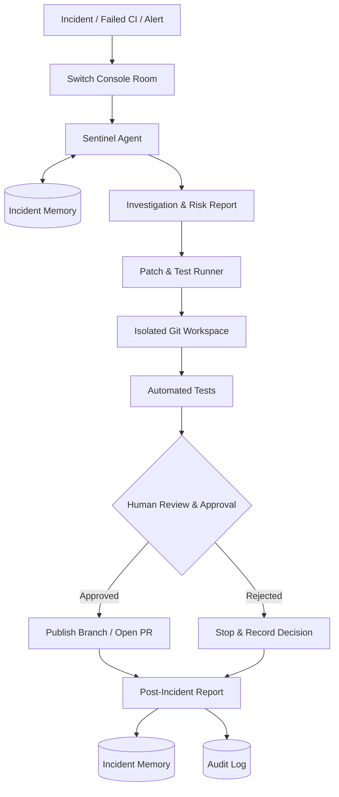

<div align="center">

# 🫀 DevPulse

### Autonomous PR & Incident Triage Engine with Persistent Memory

**Detect  ·  Recall  ·  Investigate  ·  Remediate  ·  Verify  ·  Remember**

<br />


<br />

> **Every incident becomes intelligence. Every fix becomes future knowledge.**

[The Problem](#-the-problem) ·
[How It Works](#-how-it-works) ·
[Architecture](#-architecture) ·
[Memory](#-persistent-incident-memory) ·
[Security](#-verifiable-security) ·
[Quick Start](#-quick-start) ·
[Roadmap](#-roadmap)

</div>

---

## 📖 Overview

DevPulse is an AI-powered incident investigation and remediation system. It puts **two AI agents and a human engineer in one shared Switch room**. Together they investigate a production failure, propose a tested fix, and record what was learned, with a human approving every consequential step.

| | |
|---|---|
| 🔍 **Sentinel** | Investigates the incident, recalls similar past failures, finds the likely culprit, and recommends a fix |
| 🛠️ **Patch & Test Runner** | Applies the fix in an isolated Git workspace, runs the tests, and posts the diff and results |
| 👤 **Human engineer** | Reviews the exact change and authorizes the next action |
| 🧠 **Incident Memory** | Keeps root causes, fixes and outcomes so the next similar incident starts with context |
| 🧾 **Audit Logger** | Records security-relevant events in a tamper-evident, hash-chained log |

---

## 🔥 The Problem

When something breaks in production, engineers typically have to:

- Dig through alerts, stack traces and failing CI pipelines
- Find the commit or pull request responsible
- Trace the root cause across code and logs
- Write, test and review a fix
- Coordinate with teammates
- Document what happened

It is manual, slow and repetitive. Worse, **the knowledge is lost once the incident is closed**. When a similar failure returns, the team repeats the same investigation from zero.

> **DevPulse combines autonomous investigation, controlled remediation, human oversight and reusable incident memory.**

---

## ⚙️ How It Works


| # | Stage | What happens |
|:-:|---|---|
| 1 | **Detect** | An incident, alert or failing build signal arrives in the room |
| 2 | **Recall** | Sentinel searches past incidents for similar failures and known resolutions |
| 3 | **Investigate** | Sentinel analyzes the error, relevant code and recent changes |
| 4 | **Recommend** | Sentinel produces a structured assessment and remediation proposal |
| 5 | **Patch & Test** | The Runner prepares the change in an isolated Git workspace and runs the tests |
| 6 | **Human Approval** | The exact diff and test results are presented for review |
| 7 | **Create PR** | Once authorized, the approved change is published through the configured Git workflow |
| 8 | **Remember** | Root cause, fix and outcome are recorded for future investigations |

> 🛑 **Human approval is a deliberate control point.** An AI-generated recommendation must never authorize its own production changes.

### What it looks like in the room

> *Illustrative thread. Message text will match your final agent instructions.*

```text
🚨  Alert        TypeError in checkout-service: discount is undefined

🔍  Sentinel     Similar incident found in memory: INC-0007 (null discount on bulk orders).
                 Likely culprit: PR #482, which changed the discount calculation.
                 Plan: guard the undefined case.  @runner please prepare the patch.

🛠️  Runner       Branch fix/discount-guard created from main.
                 Tests: 128 passed, 0 failed.  Diff hash: 9f2c…a41e  (attached)

👤  You          Approved. Open PR and deploy.

🛠️  Runner       PR created: <live link>

🔍  Sentinel     Incident summary posted. Saved to memory as INC-0012.
```

---

## 🏗️ Architecture

### Components

| Component | Responsibility |
|---|---|
| **Sentinel** | Incident investigation, historical recall, root-cause analysis, remediation recommendations |
| **Patch & Test Runner** | Isolated code changes, test execution, remediation preparation |
| **Human Engineer** | Reviews proposed changes and authorizes the next action |
| **Incident Memory** | Stores previous incidents, root causes, fixes and outcomes |
| **Audit Logger** | Records security-relevant workflow events and verifies log-chain integrity |

### System flow



*This diagram shows the target workflow. Integrations are being implemented incrementally, see the [Roadmap](#-roadmap).*

### Why Switch

[Switch](https://www.flintai.dev/products/switch) provides the shared room, shared context, role separation and addressing that let two agents and a human work as one team:

- **Rooms:** one channel for both agents and the humans
- **Shared context:** Sentinel's findings travel with the handoff, so the Runner never starts cold
- **Role separation:** a triager and an executor, each with one job
- **Addressing:** handoffs are explicit, directed at a specific agent or person

---

## 🧠 Persistent Incident Memory

DevPulse preserves engineering knowledge beyond any single incident session. Each resolved incident becomes a record the next investigation can reuse.

**An incident record contains:**

| Field | Purpose |
|---|---|
| Incident ID | Stable reference |
| Error signature | Used to match future failures |
| Description | What was observed |
| Root cause | Why it happened |
| Affected components | Where it happened |
| Remediation | What fixed it |
| Commit / PR | Link to the change |
| Test results | Evidence the fix worked |
| Outcome | Final resolution status |

<details>
<summary><b>📄 Example memory entry</b> (stored in <code>data/incidents.md</code>)</summary>

<br />

```markdown
## INC-0012: Undefined discount on large orders

- **Date:** 2026-11-04
- **Error signature:** `TypeError: Cannot read properties of undefined (reading 'rate')`
- **Affected components:** checkout-service / discount calculation
- **Root cause:** PR #482 removed a default discount object, so orders over
  the bulk threshold hit an undefined value.
- **Remediation:** Restored a guard for the undefined case and added a test
  for orders over the threshold.
- **Change:** PR #483
- **Tests:** 128 passed, 0 failed
- **Outcome:** Resolved. Approved by a human engineer.
- **Related:** INC-0007
```

</details>

---

## 🔐 Verifiable Security

Security is part of the design, not an afterthought. Autonomous code changes are only useful if you can trust and verify them.

### Human-in-the-loop remediation

Before a remediation is published, the workflow verifies:

- ✅ The identity of the approving engineer
- ✅ The authorized approval source (trusted Switch room)
- ✅ The exact remediation specification
- ✅ The SHA-256 hash of the proposed diff
- ✅ The freshness and uniqueness of the approval

> **Approval is bound to the exact change being reviewed.** If the diff changes after approval, the approval no longer applies.

### Phase 1 security foundation

| Mechanism | What it gives you |
|---|---|
| HMAC-SHA256 approval signatures | Approvals cannot be forged without the secret |
| Environment-based secret | No secrets in source control |
| Timestamps + replay protection | Stale or reused approvals are rejected |
| Trusted room authorization | Only approved sources can authorize actions |
| SHA-256 diff hashing | Approval is tied to the exact change |
| Patch path validation | Patches stay inside the repository boundary |
| Sensitive-data redaction | Secrets never reach audit payloads |
| Append-only JSONL audit log | Complete, ordered event history |
| Hash-chain verification | Tampering is detectable |

<details>
<summary><b>🧾 Example audit log</b> (<code>logs/audit.jsonl</code>, one JSON object per line)</summary>

<br />

> *Illustrative format. Field names will match the schema in `src/types/audit.ts`.*

```jsonl
{"seq":1,"ts":"2026-11-04T10:02:11Z","event":"incident.received","incident":"INC-0012","prevHash":"0000…","hash":"a41f…"}
{"seq":2,"ts":"2026-11-04T10:02:19Z","event":"memory.match","incident":"INC-0012","related":"INC-0007","prevHash":"a41f…","hash":"c92b…"}
{"seq":3,"ts":"2026-11-04T10:03:40Z","event":"patch.tested","incident":"INC-0012","diffSha256":"9f2c…a41e","tests":"128 passed","prevHash":"c92b…","hash":"5de0…"}
{"seq":4,"ts":"2026-11-04T10:05:02Z","event":"approval.verified","incident":"INC-0012","approver":"human","prevHash":"5de0…","hash":"7b18…"}
{"seq":5,"ts":"2026-11-04T10:05:09Z","event":"pr.created","incident":"INC-0012","prevHash":"7b18…","hash":"e3a6…"}
```

Each entry stores the hash of the previous one, so editing or deleting any line breaks the chain and verification fails.

</details>

### Incident traceability

Every remediation is explainable. DevPulse preserves what happened, what the investigation found, why a fix was recommended, which changes were proposed, who approved them, whether tests passed, and the final outcome.

---

## 🧰 Technology Stack

| Layer | Technology |
|---|---|
| Language | TypeScript |
| Runtime | Node.js 20+ |
| Agent orchestration | Switch Console |
| Agent development environment | Google Antigravity IDE |
| Validation | Zod |
| Cryptography | Node.js Crypto API |
| Audit storage | JSONL |
| Incident memory | Markdown-based storage |
| Version control | Git / GitHub |
| Testing | Node.js test runner |
| Development workflow | Wispr Flow (voice) |

*This is the selected stack and intended integrations. It does not mean every integration is already operational.*

---

## 🗂️ Project Structure

```text
DevPulse/
├── src/
│   ├── index.ts
│   ├── types/              # Zod schemas and domain types
│   │   ├── incident.ts
│   │   ├── risk-report.ts
│   │   ├── remediation.ts
│   │   ├── human-approval.ts
│   │   └── audit.ts
│   ├── utils/
│   │   └── crypto.ts       # HMAC signing, SHA-256 diff hashing
│   ├── audit/
│   │   └── audit-logger.ts # Append-only, hash-chained log
│   ├── room/               # Switch Console integration   (planned)
│   ├── sentinel/           # Investigation and recall      (planned)
│   ├── patch-runner/       # Isolated patch and test       (planned)
│   └── memory/             # Incident memory               (planned)
├── tests/
│   ├── audit-logger.test.ts
│   ├── crypto-approval.test.ts
│   ├── security.test.ts
│   └── schemas.test.ts
├── data/
│   └── incidents.md        # Incident memory store
├── logs/
│   └── audit.jsonl         # Tamper-evident audit log
├── package.json
├── tsconfig.json
└── README.md
```

Directories marked *planned* are integration points that will be added as development progresses.

---

## 🚀 Quick Start

### Prerequisites

- Node.js 20 or later
- npm
- Git
- Google Antigravity IDE
- Switch Console (for agent orchestration)

### Install

```bash
git clone <YOUR_REPOSITORY_URL>
cd DevPulse
npm install
```

### Configure

Create a local `.env` file:

```env
DEVPULSE_APPROVAL_SECRET=your-secure-random-secret-of-at-least-32-characters
```

Generate a strong secret:

```bash
node -e "console.log(require('crypto').randomBytes(32).toString('hex'))"
```

> ⚠️ **Never commit `.env` files.** Never expose secrets in frontend code, logs or source control. Use a dedicated secret manager in production, and never use example secrets.

### Validate

```bash
npm test            # unit and security tests
npm run typecheck   # TypeScript checks
npm run build       # compile the project
```

---

## 🗺️ Roadmap

DevPulse is built incrementally: **security and correctness first, autonomy second.**

- [x] **Phase 1: Foundation & Security**
  - [x] TypeScript project foundation and Zod domain schemas
  - [x] Incident, risk report, remediation and approval models
  - [x] Cryptographic diff hashing and HMAC approval signatures
  - [x] Approval integrity validation
  - [x] Hash-chained audit logging
  - [x] Security-focused unit tests (**29 passed, 0 failed**, typecheck passed)
- [ ] **Phase 2: Switch Console Integration**
  - [ ] Connect to a shared Switch Console room
  - [ ] Configure Sentinel and Patch & Test Runner agents
  - [ ] Trusted event handling and human approval interactions
  - [ ] Validate agent-to-agent collaboration
- [ ] **Phase 3: Sentinel & Incident Memory**
  - [ ] Incident ingestion
  - [ ] Historical incident retrieval and similarity-based investigation
  - [ ] Root-cause analysis
  - [ ] Structured risk and remediation reports
- [ ] **Phase 4: Patch & Test Automation**
  - [ ] Isolated Git worktrees and safe patch application
  - [ ] Automated test execution
  - [ ] Diff generation and verification
  - [ ] Human-controlled PR publication
- [ ] **Phase 5: End-to-End Incident Response**
  - [ ] Complete incident-to-remediation workflow
  - [ ] Post-incident reporting and persistent incident knowledge
  - [ ] End-to-end security and reliability validation
  - [ ] Reproducible demonstration

---

## 🎙️ Built by Voice

DevPulse is developed with **[Wispr Flow](https://wisprflow.ai)**. Prompts to the coding agent, room instructions and documentation are dictated rather than typed, as part of the *Code with Wispr* challenge. The Wispr usage scorecard is included with the project submission.

---

## 🛡️ Security Considerations

1. AI agents are never trusted as human approvers.
2. Approval is tied to the exact proposed changes.
3. Unauthorized or stale approvals are rejected.
4. Patches must stay within the intended repository boundary.
5. Secrets and credentials must not appear in audit records.
6. Audit integrity is independently verifiable.
7. Production actions require explicit authorization.

> **Important:** a passing unit test suite is not a production security assessment. Trusted identity integration, persistent replay prevention, multi-process audit safety and external audit-integrity anchoring all need additional validation before production use.

---

## 🔭 Vision

DevPulse aims to move incident response from reactive manual investigation toward controlled, memory-driven autonomous engineering:

- Incidents are investigated with historical context
- Root causes are identified with supporting evidence
- Remediation is proposed with measurable confidence
- Code changes are tested before human approval
- Engineers stay in control of consequential actions
- Every resolved incident strengthens the next investigation

**The goal is not to replace engineers. It is to give them a system that learns from their operational history and helps them respond faster, more consistently and more safely.**

---

## 📄 License

License to be determined.

---

<div align="center">

**DevPulse**  ·  *Every incident becomes intelligence. Every fix becomes future knowledge.*

</div>
